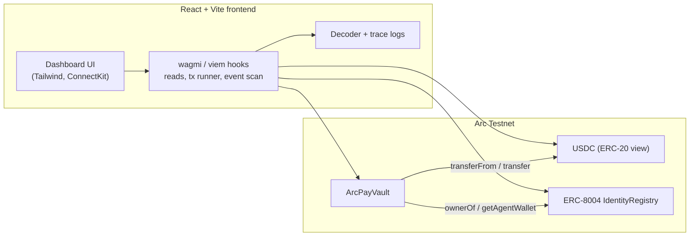
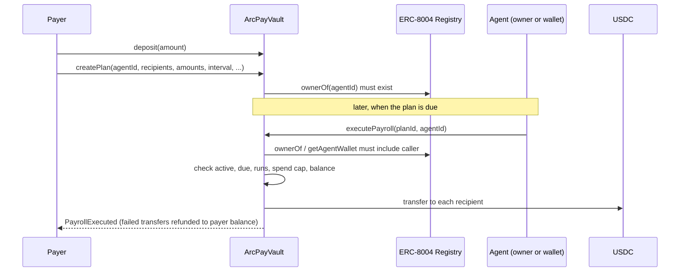

# ArcPay Automated Vault

A USDC vault on [Arc Testnet](https://docs.arc.io) with one-transaction batch payments and automated payroll that only a registered [ERC-8004](https://eips.ethereum.org/EIPS/eip-8004) agent can release, after the contract re-checks every rule onchain.

Built with [Arc Studio](https://studio.arc.io)

| | |
|---|---|
| **Network** | Arc Testnet (chain ID `5042002`) |
| **Vault** | [`0x405438ec99cda31b5ece7788d1f96cd12cd376c6`](https://explorer.testnet.arc.io/address/0x405438ec99cda31b5ece7788d1f96cd12cd376c6) (source verified) |
| **USDC** | `0x3600000000000000000000000000000000000000` (6 decimals) |
| **ERC-8004 Identity Registry** | `0x8004A818BFB912233c491871b3d84c89A494BD9e` |
| **Faucet** | https://faucet.circle.com |

Machine-readable deployment details: [`deployments/arc-testnet.json`](deployments/arc-testnet.json).

---

## Features

**USDC vault**
- Deposit and withdraw USDC against your own vault balance. Withdrawals keep working even while the vault is paused.
- Live wallet balance, vault balance and total value locked, read straight from Arc Testnet.

**Batch payments**
- Pay up to 100 wallets in a single transaction from your vault balance.
- A payment that cannot be delivered (for example to a blocked address) is refunded to your vault balance and does not block the others.

**Automated payroll with ERC-8004 agent integration**
- Create a payroll plan: recipients, amounts, interval (1 minute to 365 days), maximum runs and a spend cap. Plans never lock your funds; payroll draws from your live vault balance at execution time.
- Each plan is assigned an ERC-8004 agent. Only the agent's registry owner or registered wallet can run the plan.
- Before any USDC moves, the vault checks that the plan is active, the agent matches, the caller operates that agent, the payment is due, runs remain, the spend cap is respected and your vault balance covers the run.
- Register an agent directly from the app. The same wallet can be payer and agent, so you can try the full loop alone.

**Observability**
- Decoded calldata before you sign and a decoded receipt (function, arguments, events, gas) after confirmation.
- Execution log of vault events, a trace of every contract call you send, and a JSON-RPC log. Each action is also grouped by name in the Arc Studio Tracing panel when run inside Arc Studio.

**Security**
- Reentrancy-guarded state changes, checks-effects-interactions ordering, two-step ownership, disabled ownership renouncement, constructor sanity checks. The owner can only pause and unpause; it can never move user funds.
- Reviewed at maximum depth by two independent reviews plus static analysis, with 132 passing unit, fuzz and invariant tests. See [`docs/security-review.md`](docs/security-review.md).

---

## Architecture



### Payroll execution flow



### Components

| Layer | Path | Responsibility |
|---|---|---|
| Contract | `contracts/ArcPayVault.sol` | Custody accounting, batch payments, rule-gated payroll |
| Tests | `contracts/test/` | Unit, fuzz, invariant and reentrancy tests with mocks |
| Deploy | `contracts/script/DeployArcPayVault.s.sol` | Foundry deployment script (Arc Testnet defaults) |
| Frontend | `src/` | React dashboard |
| Styles | `src/styles/app.css`, `src/index.css` | Design tokens and component classes (Tailwind `@apply`) |
| Contract bindings | `src/contracts/vaultAbi.ts`, `src/lib/vault.ts` | ABI and addresses |
| Decoding and logs | `src/lib/decode.ts`, `callLog.ts`, `rpcLog.ts` | Calldata/receipt decoding, call trace, RPC log |

---

## Project structure

```
.
├── contracts/
│   ├── ArcPayVault.sol              # the vault
│   ├── script/
│   │   ├── DeployArcPayVault.s.sol  # deploy script
│   │   ├── Create2Factory.sol       # optional deterministic deployment helper
│   │   └── DeployCreate2.s.sol
│   └── test/                        # 132 tests (unit, fuzz, invariants, reentrancy)
├── deployments/arc-testnet.json     # addresses, deploy tx and block
├── docs/security-review.md          # review findings and resolutions
├── lib/forge-std/                   # vendored Foundry test library
├── scripts/
│   ├── sync-abi.ts                  # regenerate src/contracts/vaultAbi.ts
│   ├── export_zip.py                # build the release archive
│   └── check.sh                     # lint + typecheck
├── src/
│   ├── App.tsx                      # page composition
│   ├── components/                  # Header, BalanceHero, MoneyForm, BatchTransfer,
│   │                                # PayrollPlanner, AgentPanel, TracePanel, ...
│   ├── hooks/                       # useVaultState, usePlans, useAgent, useTxFlow, ...
│   ├── lib/                         # vault.ts, decode.ts, callLog.ts, rpcLog.ts
│   ├── contracts/vaultAbi.ts        # generated ABI
│   ├── styles/app.css               # component styles
│   ├── onchain-facts.ts             # chain + USDC facts (generated by Arc Studio)
│   ├── onchain-money.ts             # USDC amount parsing/formatting helpers
│   └── config.ts, main.tsx, tracing.ts, ...
├── .env.example
├── foundry.toml, remappings.txt
├── package.json, tailwind.config.js, postcss.config.js, tsconfig.json, vite.config.ts
└── LICENSE
```

---

## Getting started

### Prerequisites

- [Bun](https://bun.sh) 1.x (npm also works: replace `bun run` with `npm run`)
- [Foundry](https://getfoundry.sh) (`forge`, `cast`) for the contract
- A browser wallet (MetaMask or similar) on Arc Testnet
- Testnet USDC from https://faucet.circle.com. USDC is also the gas token on Arc.

### Run the app

```bash
bun install
cp .env.example .env      # already points at the deployed vault
bun run dev               # http://localhost:5173
```

Connect your wallet; the app asks to switch to Arc Testnet (chain ID `5042002`, RPC `https://rpc.testnet.arc.io`).

### Environment variables

| Variable | Used by | Purpose |
|---|---|---|
| `VITE_VAULT_ADDRESS` | frontend | Deployed `ArcPayVault` address |
| `VITE_VAULT_DEPLOY_BLOCK` | frontend | First block of the event scan |
| `ARC_TESTNET_RPC_URL` | Foundry / cast | RPC endpoint for deployment and CLI calls |
| `OWNER_ADDRESS`, `USDC_ADDRESS`, `IDENTITY_REGISTRY` | deploy script (optional) | Override constructor arguments |
| `PRIVATE_KEY` | deploy (optional) | Throwaway testnet key only. Prefer `cast wallet import` and `--account` |

Never commit `.env`. It is git-ignored.

---

## Using the app

1. **Fund**: get testnet USDC from the faucet.
2. **Deposit**: enter an amount, press **Deposit**. The first deposit asks for two confirmations (allow USDC, then deposit). The decoded call is shown before you sign.
3. **Withdraw**: enter an amount, press **Withdraw** to move USDC back to your wallet.
4. **Batch transfer**: add recipient rows (or **3 test wallets** / **My wallet**), review the total, press **Send**. Live recipient balances appear afterwards.
5. **Register an agent**: in **Agent status**, press **Register new agent** (or enter an existing agent ID). The app shows whether your wallet operates that agent.
6. **Create payroll**: in **Automated payroll**, set recipients, interval, maximum runs, and press **Create payroll plan**.
7. **Run payroll**: when a plan's checklist is all green, press **Execute as agent**. Watch the **Execution logs and traces** panel for `PayrollRuleVerified` and `PayrollExecuted`.

---

## Smart contract reference

`contracts/ArcPayVault.sol`, Solidity `^0.8.20` (compiled with 0.8.28, Cancun), OpenZeppelin Contracts 5.6.1 (`Ownable2Step`, `Pausable`, `ReentrancyGuard`, `SafeERC20`).

All amounts are raw USDC units (6 decimals): `1 USDC = 1000000`.

### Functions

| Function | Who | Notes |
|---|---|---|
| `deposit(amount)` | anyone | Needs prior USDC `approve`. Blocked while paused |
| `withdraw(amount)` | depositor | Always available, even when paused |
| `batchTransfer(recipients[], amounts[])` | depositor | 1 to 100 recipients. Failed transfers are refunded to the caller's vault balance |
| `createPlan(agentId, recipients[], amounts[], interval, firstExecutionAt, maxExecutions, spendCap)` | payer | Interval 60 s to 365 days. `firstExecutionAt = 0` means now. Agent must exist in the registry. Does not reserve funds |
| `cancelPlan(planId)` | plan payer | Works while paused |
| `setPlanAgent(planId, newAgentId)` | plan payer | Plan must be active |
| `previewExecution(planId, agentId, operator)` | view | Returns `(Check code, totalPerRun)` without changing state |
| `isAgentOperator(agentId, operator)` | view | True if operator is the agent's registry owner or registered wallet |
| `executePayroll(planId, agentId)` | agent operator | Reverts `RuleViolated(code)` if any rule fails |
| `getPlan(planId)`, `getPlanIdsByPayer(payer)`, `balanceOf(account)` | view | |
| `pause()`, `unpause()` | owner | Owner cannot touch user funds |
| `transferOwnership(newOwner)`, `acceptOwnership()` | owner / pending owner | Two-step handover. `renounceOwnership()` always reverts |

Public state: `usdc`, `identityRegistry`, `balances(address)`, `totalDeposits`, `planCount`, `paused`, `owner`, `pendingOwner`, `MAX_RECIPIENTS` (100), `MIN_INTERVAL` (60), `MAX_INTERVAL` (365 days).

### Rule check codes (`Check`)

| Code | Meaning |
|---|---|
| 0 `Ok` | Ready to execute |
| 1 `Paused` | Vault paused |
| 2 `PlanInactive` | Cancelled, finished or unknown plan |
| 3 `AgentMismatch` | `agentId` is not the plan's agent |
| 4 `NotAgentOperator` | Caller is not the agent's owner or wallet |
| 5 `TooEarly` | Not due yet |
| 6 `MaxRunsReached` | All runs used |
| 7 `SpendCapExceeded` | Another run would exceed the cap |
| 8 `InsufficientBalance` | Payer's vault balance is too low |

### Events

`Deposited`, `Withdrawn`, `BatchTransferred`, `PaymentSent`, `PaymentFailed`, `PlanCreated`, `PlanCancelled`, `PlanAgentChanged`, `PayrollRuleVerified`, `PayrollExecuted`, plus OpenZeppelin `Paused`, `Unpaused`, `OwnershipTransferStarted`, `OwnershipTransferred`.

### Behavior worth knowing

- A scheduled run is consumed even if some of its payments fail; failed amounts are refunded to the payer's vault balance and removed from the plan's `spent`.
- Missed runs cannot be caught up in a burst: the next run is scheduled `interval` seconds after each execution.
- All depositors' USDC is pooled at the vault address. If the USDC issuer blocklisted that address, withdrawals could fail for everyone. Internal refunds and pausing cannot recover issuer-frozen funds.
- A 100-recipient `executePayroll` costs roughly 3.7M gas. Use fewer recipients per plan if a run fails on gas.

---

## Contract interaction guide (Foundry `cast`)

```bash
export RPC=https://rpc.testnet.arc.io
export VAULT=0x405438ec99cda31b5ece7788d1f96cd12cd376c6
export USDC=0x3600000000000000000000000000000000000000
export ME=0xYourAddress
# Add --account <keystore-name> (or --private-key for a throwaway key) to every `cast send`.
```

**Read state**

```bash
cast call $VAULT "balanceOf(address)(uint256)" $ME --rpc-url $RPC
cast call $VAULT "totalDeposits()(uint256)" --rpc-url $RPC
cast call $VAULT "identityRegistry()(address)" --rpc-url $RPC
cast call $VAULT "paused()(bool)" --rpc-url $RPC
```

**Deposit 5 USDC and withdraw 1 USDC**

```bash
cast send $USDC "approve(address,uint256)" $VAULT 5000000 --rpc-url $RPC --account deployer
cast send $VAULT "deposit(uint256)" 5000000 --rpc-url $RPC --account deployer
cast send $VAULT "withdraw(uint256)" 1000000 --rpc-url $RPC --account deployer
```

**Batch transfer**

```bash
cast send $VAULT "batchTransfer(address[],uint256[])" \
  "[0xRecipientA,0xRecipientB]" "[500000,250000]" --rpc-url $RPC --account deployer
```

**Register an ERC-8004 agent** (the registration URI can be `ipfs://`, `https://` or a `data:` URI)

```bash
export REGISTRY=$(cast call $VAULT "identityRegistry()(address)" --rpc-url $RPC)
cast send $REGISTRY "register(string)" "https://example.com/agent.json" --rpc-url $RPC --account deployer
# The new agent ID is in the Registered event of the transaction receipt.
```

**Create and run a payroll plan**

```bash
# agent 123 pays two recipients 0.5 USDC each, every 60 s, up to 3 runs, spend cap 3 USDC
cast send $VAULT \
  "createPlan(uint256,address[],uint256[],uint64,uint64,uint32,uint256)" \
  123 "[0xRecipientA,0xRecipientB]" "[500000,500000]" 60 0 3 3000000 \
  --rpc-url $RPC --account deployer

cast call $VAULT "getPlanIdsByPayer(address)(uint256[])" $ME --rpc-url $RPC
cast call $VAULT "previewExecution(uint256,uint256,address)(uint8,uint256)" 1 123 $AGENT_OPERATOR --rpc-url $RPC
cast send $VAULT "executePayroll(uint256,uint256)" 1 123 --rpc-url $RPC --account agent
cast send $VAULT "cancelPlan(uint256)" 1 --rpc-url $RPC --account deployer
```

`previewExecution` returning `0` means every rule passes.

**Admin (owner only)**

```bash
cast send $VAULT "pause()" --rpc-url $RPC --account owner
cast send $VAULT "transferOwnership(address)" $NEW_OWNER --rpc-url $RPC --account owner
cast send $VAULT "acceptOwnership()" --rpc-url $RPC --account new_owner
```

---

## Development

```bash
bun run contracts:build   # forge build
bun run contracts:test    # forge test (unit, fuzz, invariants)
bun run abi:sync          # regenerate src/contracts/vaultAbi.ts after contract changes
bun run check             # lint + typecheck
bun run build             # typecheck + production build to dist/
bun run preview           # serve the production build
```

Contract imports resolve through `remappings.txt`: `@openzeppelin/contracts/` points at `node_modules`, so run `bun install` before `forge build`. `forge-std` is vendored in `lib/forge-std`; if you prefer a submodule, run `git init && rm -rf lib/forge-std && forge install foundry-rs/forge-std`.

### Deploy your own vault

```bash
cast wallet import deployer --interactive

# Simulate first (nothing is sent)
forge script contracts/script/DeployArcPayVault.s.sol --rpc-url arc_testnet

# Broadcast
forge script contracts/script/DeployArcPayVault.s.sol --rpc-url arc_testnet --account deployer --broadcast
```

Then update `VITE_VAULT_ADDRESS` and `VITE_VAULT_DEPLOY_BLOCK` in `.env`, restart `bun run dev`, and verify the source on the Arc Testnet explorer:

```bash
forge verify-contract <VAULT_ADDRESS> contracts/ArcPayVault.sol:ArcPayVault \
  --chain-id 5042002 \
  --verifier blockscout --verifier-url https://explorer.testnet.arc.io/api/ \
  --compiler-version 0.8.28 --num-of-optimizations 200 --evm-version cancun \
  --constructor-args $(cast abi-encode "constructor(address,address,address)" $OWNER $USDC $REGISTRY) \
  --watch
```

### Export a release archive

```bash
bun run export:zip        # writes exports/arcpay-automated-vault.zip
```

The archive contains source, tests, scripts, docs and configs. It leaves out `node_modules`, build output, `.env` and logs.

---

## Security

- This is testnet software. Get an independent third-party audit before any mainnet use.
- The automated review found and fixed: ownership renounce lockout, a single failing recipient blocking a batch, single-step ownership transfer, missing constructor contract checks, and thin error context. Details in [`docs/security-review.md`](docs/security-review.md).
- Never paste private keys into the app or commit them. Use Foundry keystores for deployment.
- Test wallets generated in the UI are throwaway addresses whose keys are discarded.

## Troubleshooting

| Symptom | Fix |
|---|---|
| `forge build` cannot find `@openzeppelin/...` | Run `bun install` first (remappings use `node_modules`) |
| App shows a blank vault address or no events | Check `VITE_VAULT_ADDRESS` / `VITE_VAULT_DEPLOY_BLOCK`, then restart the dev server |
| Transaction fails with `RuleViolated(code)` | Look up the code in the table above, or call `previewExecution` |
| Execution log looks empty | The scan covers a bounded recent window; very old events are not shown |
| Wallet is on the wrong network | Accept the network switch prompt (Arc Testnet, chain ID `5042002`) |

## License

[MIT](LICENSE)
